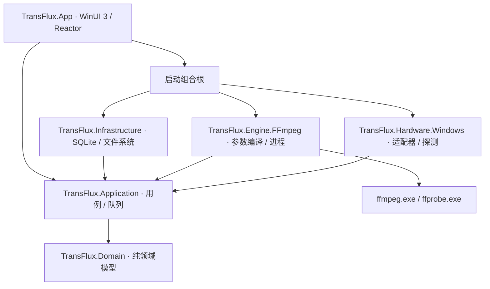

# 04 · 系统架构

## 2026-11-01 工作台实现修订

`WorkbenchStore` 统一管理导入、选择、参数变更、任务绑定、撤销和可见项目持久化；
`AppRoot` 负责 Reactor 布局与窗口/文件选择器互操作，`OutputSettingsPanel` 编辑所选项目，`TaskRow` 显示完整生命周期。
旧的独立 JobQueueStore、WorkbenchReducer、ParameterDialog、BatchDialog、ConversionForm 和 ShellContext 已移除。

每张卡片有稳定 MediaId，入队后显式绑定 JobId，不能按源路径或 SourceSnapshotId 合并独立转换。
Submitting 状态锁定修改和移除；已绑定的参数由不可变 RequestSnapshot 校正。
控制器不依赖 WinUI，通知由 Reactor 组件投递到 DispatcherQueue；进度通知按 250ms 合并。
媒体读取限制并发，每项都有取消令牌；移除/撤销不会接纳旧读取的迟到结果。

`IWorkspacePersistence` 在 Infrastructure 通过 SQLite settings 的 `workspace.v1` 保存可见卡片。
恢复后，通过 WatchAsync 初始 Job/Attempt/Output 投影关联执行信息，SnapshotCompleted 标识初始化完成。
历史已清空的悬空 JobId 不会自动成为待执行草稿。未开始文件重新读取媒体信息。
宿主完成恢复后先暂停调度，再启动循环，用户明确继续才恢复等待任务。
ConfigureExecution 原子更新后续策略；并发门槛基于在途任务数量，不终止已有任务。
回退/验证策略在任务开始时捕获；暂停在启动任务前复核。
AppRoot 拦截退出：有活动任务时提供继续/取消退出，等待安全终态后保存并关闭。

以下目录结构为早期建议；当前交互与生命周期以本节及 [03](03-ui-ux.md) 为准。

## 模块依赖



接口与用例契约放 Application；值类型与不变量放 Domain。Infrastructure、Engine、Hardware 不能引用 App。Domain 不引用 WinUI、Reactor、SQLite 或 Process。组合根负责依赖注入和启动顺序，不能让页面直接访问数据库、拼命令或启动进程。

## 建议解决方案

```text
TransFlux.sln
global.json                       # M0 写入已验证 SDK
Directory.Build.props             # nullable、告警、语言版本
Directory.Packages.props          # 精确包版本
src/
  TransFlux.App/                   # 启动、Reactor 组件、主题、资源
    Components/{Shell,Convert,Queue,Presets,Settings,Shared}/
    State/                        # UI reducers、选择器、投影
    Interop/                      # 原生控件包装、窗口与 picker 互操作
  TransFlux.Domain/               # Media、Plans、Jobs、Presets
  TransFlux.Application/          # 用例、接口、调度、预检
  TransFlux.Engine.FFmpeg/        # Probe、Compiler、Runner、Progress
  TransFlux.Hardware.Windows/     # Adapter、Capability、路径验证
  TransFlux.Infrastructure/       # SQLite、日志、文件与配置
tests/
  TransFlux.Domain.Tests/
  TransFlux.Application.Tests/
  TransFlux.Engine.IntegrationTests/
  TransFlux.App.UITests/
packaging/                        # MSIX、第三方清单、构建脚本
docs/evidence/                    # 实际构建、截图、测试与基准
```

这是待创建结构，不表示项目现存；不要为占位而创建空类和空测试。项目拆分是逻辑边界，M0 可先建立必要最小项目，M1 前落实依赖约束。

## Reactor 核心约束

UI 使用 `Component`、声明式渲染和状态驱动更新；准确类型、命名空间和 hook 重载以锁定版本官方样例为准。主页面不是 XAML 页配少量 Reactor 按钮。

UI 状态分三类：组件局部状态（折叠/弹窗/输入草稿）、工作台会话状态（选择/预设编辑/草稿）、持久领域状态（队列/attempt/历史）。局部状态用 hooks；工作台用 reducer；长期任务由应用服务持有，组件只订阅投影。可用 `UseExternalStore` 桥接，经 M0 确认可用性；自写订阅桥也必须有卸载清理。

规则：

- Render 是纯计算，不做 I/O、不启动任务、不创建服务、不触发数据库写入。
- Hooks 顺序稳定，不放在条件/循环内。异步 effect 通过取消令牌与版本号防止卸载后写入。
- 订阅、计时器与原生事件由 effect 生命周期注册/清理；全局服务不由组件重渲染重复实例化。
- 每个行元素使用稳定 JobId/MediaId key；进度更新不能重建整页或丢焦点。
- 后台事件经 UI Dispatcher 投影；服务不捕获控件引用。UI 事件只发 command，不直接修改状态快照。
- `UsePersisted` 不能当作磁盘数据库；是否跨进程持久化必须由 SQLite 实现，不能因 hook 名字推断。
- 高频统计合并后再推送，终态与错误不丢失；日志流不进入整棵 UI 状态树。

Reactor 原生控件互操作限于：未包装的 WinUI 控件、HWND/窗口、文件选择器、可访问性补充。每个适配器有明确 owner、创建和释放时点；同一原生元素不能同时挂到两个父级。

## 线程与执行模型

UI 线程只渲染和处理轻量状态。目录枚举、probe、预检、进程读取、数据库和缩略图均异步/后台执行；禁止 `.Result` / `.Wait()` 阻塞 UI。数据库采用单写者执行队列，事务短小，不在事务内等待 FFmpeg。

调度器为应用级单例，使用有界 Channel 接收命令；状态迁移由单一顺序执行器判定，耗时 I/O 另行运行并返回带 attemptId 的结果。多任务可以并发，但同一任务不会被两个 worker 同时领取。进度消息与命令可用独立通道，避免高频消息阻塞取消。

## 一次转换的生命周期

1. ImportUseCase 创建草稿并启动 Probe，返回 MediaSnapshot。
2. PlanUseCase 校验 preset + stream selection，获取设备候选与输出策略，生成可解释 ExecutionPlan。
3. QueueUseCase 冻结请求和输入指纹，事务创建 Job；当前计划版本及哈希同时保存。
4. Scheduler 原子领取，重新预检输入/空间/目标/设备，预留输出名与资源令牌，创建 attempt。
5. Runner 启动受管理进程，持续读取 stdout/stderr，合并发布阶段与进度。
6. 退出成功后进入验证；Verifier 检查实际流、时长、尺寸及解码采样。
7. OutputCommitter 提交目标；事务记录成功。若落库失败，下次通过提交日志恢复。
8. 失败/取消回收进程、令牌、预留和临时文件，再落终态；不能只在 UI 删除卡片。

## 核心替换边界

`IMediaProbe`、`IExecutionPlanner`、`IMediaRunner`、`IOutputVerifier` 保持 FFmpeg 细节在适配层。领域能力使用“支持 H.264 编码”等语义，FFmpeg 参数名在 engine 中映射；但不提前做任意核心插件宿主。替换 Media Foundation/GStreamer 需另写能力与计划编译器并通过相同语义测试。

## 可观测性与故障域

所有事件带 correlationId、jobId、attemptId；同一 attempt 的顺序号单调递增。记录计划、进程退出、降级、验证与输出提交等关键事件。UI 故障不能误标成功；FFmpeg 崩溃只影响对应 attempt；数据库损坏进入恢复界面，不自动覆盖损坏文件。应用与 FFmpeg 同用户权限运行，进程隔离不等同于安全沙箱。
