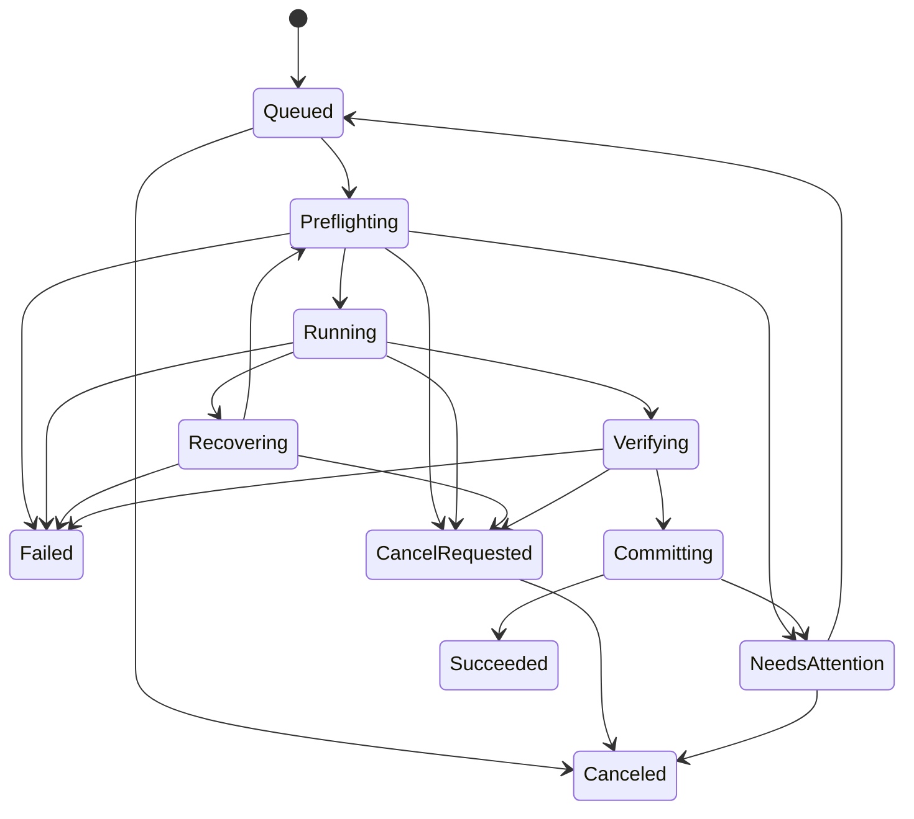

# 07 · 数据、接口与状态契约

## 2026-11-01 工作台契约增量

- 输出分层扩展：ConversionRequest / PresetRequestTemplate 新增 VideoCodec（默认 H264）；ConversionMode 继续区分转码、音频输出和转封装。
  ContainerFormat、VideoCodec、AudioCodec 新值只追加，不更改旧序号；兼容矩阵统一由 OutputFormatCatalog 提供。
  可用组合见 [输出格式记录](evidence/OUTPUT-FORMATS.md)。

- `WorkspaceEntry(MediaId, SourcePath, Request, JobId?)` 经 IWorkspacePersistence 存入 settings 的 `workspace.v1`。
  Request 记录未开始项目参数；绑定后以执行 RequestSnapshot 为准。恢复时重新探测未开始项目。
- 工作台移除只删除可见卡片；历史与源/输出文件独立保留。撤销恢复同一 MediaId/JobId。
  工作台加载返回 null 表示从未保存，空列表表示已保存的空工作台，避免把已移除的中断任务重新带回。
  新任务在卡片绑定持久化前保持暂停，避免崩溃造成不可见的已启动任务。
- SnapshotCompleted 在初始查询（包括零任务）后发出；Snapshot 同时携带最新 Attempt、Output 和可用的 Failure。
  查询失败向观察者传播，不能伪装空队列；后续事件不能回滚已有 Job.Revision。
- IJobService.ConfigureExecution 更新后续调度并发、回退和完整验证；执行中的任务捕获旧策略。
- Recovering 允许取消；Committing 之后拒绝取消。
- PresetRequestTemplate 新增可空宽/高、CRF、视频码率、帧率、音频采样率/声道及硬件后端；旧 JSON 缺失字段使用默认值。
  不包含输出路径、文件名、裁剪和源轨道编号。
- 恢复时 Committing 任务已有对应 OutputRecord，应补齐成功终态与 Attempt，避免诱导重复转换。

本节是当前实现增量，其余旧接口示例以代码为准。

## 领域模型

ID 采用不可变 GUID，时间以 UTC 存储，UI 本地化显示。媒体时长使用整数微秒或 TimeSpan ticks，帧率/SAR/time_base 使用分子分母有理数；Unknown 用 nullable/显式联合状态，不用 0、NaN 或空字符串混淆。

| 模型 | 必要字段与约束 |
|---|---|
| SourceSnapshot | mediaId、absolutePath、sizeBytes、modifiedUtc、probeSchemaVersion、streams、format、durationUs?、colorClassification |
| StreamDescriptor | sourceIndex、kind、codec、language?、disposition、媒体专属属性、sideData 摘要 |
| ConversionRequest | requestVersion、sourceSnapshotId、mode、container、selectedStreamIndices、qualityTier、speedTier、resize、trim?、audioPolicy、metadataPolicy、hardwarePreference、outputPolicy |
| Preset | presetId、schemaVersion、revision、name、builtIn、requestTemplate；不包含机器专属输出路径与设备 LUID |
| ValidatedPlan | planId、planSchemaVersion、requestHash、coreHash、capabilityHash、candidatePaths、expectedOutput、warnings、parameterPlan、resourceNeeds |
| Job | jobId、requestSnapshot、sourceFingerprint、enqueueOrder、state、revision、activeAttemptId?、createdUtc、updatedUtc |
| Attempt | attemptId、jobId、ordinal、planSnapshot、coreIdentity、deviceIdentity、tempPath、reservedFinalPath、state、startedUtc?、endedUtc?、exitCode?、failureCode?、fallbackReason? |
| ProgressSnapshot | jobId、attemptId、sequence、stage、processedUs?、fraction?、speed?、eta?、bytesWritten?、sampledUtc |
| OutputRecord | jobId、attemptId、finalPath、size、verificationSummary、committedUtc、commitToken |
| CapabilityRecord | cacheKey、deviceIdentity、probeSpec、status、reason、testedUtc、expiresUtc? |

状态快照不可变；UI 不持有可被后台线程直接修改的集合。序列化 enum 用稳定字符串并处理未知值；请求、预设、计划分别有版本，不依赖程序集版本反序列化。密码、任意用户命令、不受限协议选项不属于 request。

## 状态机

草稿导入独立于 Job：`Discovered → Probing → Ready / Invalid`。只有预检可接受的草稿能冻结成排队 Job；Invalid 可重新探测，不将 UI 错误行冒充执行失败。



进程异常退出后，恢复器把所有非终态活动任务标 `Interrupted`（提交中的特殊恢复见下），不自动续跑。`Interrupted/Failed/Canceled` 的重试创建新 Job，保留 `retryOfJobId`；自动能力回退则在同 Job 内创建下一 Attempt，并保持旧 attempt 失败记录。`NeedsAttention → Queued` 仅在输入没变且解决可外部恢复问题后允许；变更源或转换参数创建新 Job。

队列的 `Paused/Running` 是调度器状态，不是每个 job 的 Paused。暂停不冻结 FFmpeg；没有“已暂停进程”状态。

## 竞态与不可变规则

1. 每个 job 最多一个活跃 attempt；数据库条件更新 `WHERE revision = expected AND state = ...` 实现领取与迁移。
2. 进度含 attemptId + sequence；过期 attempt 和乱序消息丢弃，不把 90% 旧进度写入新尝试。
3. 取消和完成由状态机仲裁：验证前收到取消则清理为取消；进入 Committing 后拒绝取消并显示“正在保存”，保证提交原子边界。取消按钮此阶段禁用。
4. `Succeeded` 仅在输出提交成功、OutputRecord 已持久化后发出；先写提交意图再文件操作，恢复时补齐事务。
5. 崩溃无法把磁盘 rename 与 SQLite 做成同一事务，必须用提交日志恢复，不声称“单事务保证文件和数据库一致”。提交失败导致的 NeedsAttention 必须先对账，只有确认未发布输出且旧资源已清理才允许重新排队；不直接重跑产生重复成品。
6. 排队时冻结 request，执行时重新验证 core/device/input；核心变化需要重新编译 plan 并记录差异，不能执行旧参数假装原计划。
7. 用户修改工作台或 preset 不改变已排队记录。日志清理不能删除活跃 attempt 的资源。

## 接口草案（应用自有契约）

```csharp
public interface IMediaProbe
{
    Task<ProbeResult> ProbeAsync(SourceReference source, CancellationToken ct);
}
public interface ICapabilityService
{
    Task<CapabilitySnapshot> GetAsync(CapabilityQuery query, CancellationToken ct);
}
public interface IExecutionPlanner
{
    Task<PlanResult> BuildAsync(ConversionRequest request,
        SourceSnapshot source, CapabilitySnapshot capabilities,
        CancellationToken ct);
}
public interface IMediaRunner
{
    Task<RunResult> RunAsync(AttemptContext attempt,
        IProgress<EngineProgress> progress, CancellationToken ct);
}
public interface IOutputVerifier
{
    Task<VerificationResult> VerifyAsync(VerificationRequest request,
        CancellationToken ct);
}
public interface IJobService
{
    Task<JobId> EnqueueAsync(EnqueueRequest request, CancellationToken ct);
    Task<CancelResult> CancelAsync(JobId id, CancellationToken ct);
    Task<JobId> RetryAsync(JobId id, CancellationToken ct);
    IAsyncEnumerable<JobEvent> WatchAsync(JobWatchQuery query,
        CancellationToken ct);
}
```

类型为后续代码需实现的概念，不是库现有 API。结果用可判别 Success/ValidationFailure/OperationalFailure 表达，取消与错误分开；不可把 `null` 当万能失败。命令取消令牌控制调用等待，已持久化 Job 不因 UI 导航令牌取消；执行取消必须走 CancelAsync。Watch 要支持初始快照+cursor，或原子订阅后快照并按 sequence 去重，避免快照与订阅间漏事件。

## SQLite 存储设计

数据库路径逻辑为用户本地数据目录 `TransFlux/state.db`，打包应用通过专门路径服务选用实际 LocalState 根，不假定与未打包路径相同。启用 foreign_keys、WAL、busy_timeout，事务 durability 初始选 FULL，测量后再讨论调整；单实例应用加命名互斥与 IPC 激活，互斥名按用户与应用身份区分。

| 表 | 主键 / 内容 | 索引 |
|---|---|---|
| schema_migrations | version、applied_utc、checksum | version unique |
| sources | id、fingerprint、probe_json、schema_version | normalized_path + size + modified_utc |
| jobs | id、request_json、source_id、state、revision、enqueue_order、retry_of、时间 | state + enqueue_order |
| attempts | id、job_id、ordinal、plan_json、状态、路径、错误与时间 | job_id + ordinal unique |
| outputs | job_id、attempt_id、path、commit_token、verification_json | attempt_id unique |
| commit_journal | commit_token、attempt_id、phase、temp/final、文件身份 | commit_token unique |
| presets | id、revision、schema_version、payload_json、built_in | id + revision |
| capability_cache | cache_key、payload_json、tested_utc | cache_key unique |
| settings | key、schema_version、value_json | key unique |

JSON 保存不可变业务快照，常查询状态与时间列单独存；不把 sqlite 当日志文件。约束 source/attempt 外键与 unique，terminal 标记使用明确状态集合。迁移事务前备份，WAL 模式使用 SQLite backup API 或一致性 checkpoint/关闭连接后复制，不直接只拷贝在线 `.db`。迁移失败保留旧库，显示恢复入口，不能删库“自愈”。

进度只驻内存，必要时每 5 秒节流 checkpoint；终态、attempt 变化和提交日志立即落库。数据库错误不允许 UI 显示已保存成功。日志与 DB 分开保存，诊断中记录迁移版本。

## 预设格式示例

```json
{
  "schemaVersion": 1,
  "id": "7be6b774-e56d-4b90-9e62-d1f96bb79538",
  "revision": 1,
  "name": "通用视频 · 均衡",
  "builtIn": true,
  "template": {
    "mode": "VideoTranscode",
    "container": "Mp4",
    "videoCodec": "H264",
    "qualityTier": "Balanced",
    "speedTier": "Balanced",
    "resize": { "mode": "KeepDisplaySize", "allowUpscale": false },
    "audio": { "codec": "Aac", "bitrateKbps": 192 },
    "metadataPolicy": "StripPersonalTags"
  }
}
```

示例是设计数据，不是完整运行配置。导入预设限制大小、深度、枚举与范围；未来 schema 版本只读提示不支持，不能丢字段后保存。预设保存用途，不保存某台机器的 FFmpeg 参数、路径或已验证能力。

## 错误分类

统一码：`CORE_MISSING / CORE_INTEGRITY_FAILED / INPUT_CHANGED / PROBE_FAILED / UNSUPPORTED_MEDIA / PLAN_INVALID / OUTPUT_CONFLICT / DISK_FULL / ACCESS_DENIED / DEVICE_UNAVAILABLE / ENCODER_INIT_FAILED / PROCESS_FAILED / VERIFY_FAILED / COMMIT_FAILED / DB_FAILED / INTERRUPTED`。每项含 userMessageKey、technicalDetail、retryability、suggestedActions；技术 stderr 是证据，不能直接替代用户文案。
