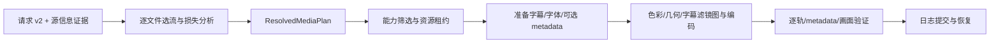

# 14 · Dolby、HDR 与内封字幕烧录：目标及实现路径

日期：2026-11-01（Asia/Shanghai）。状态：**待实现的产品/工程方案**，不是现有支持声明。用户已确认同时规划 Dolby 音频与 Dolby Vision 视频。前置审查见 [13](13-project-review.md)，编码入口见 [15](15-advanced-media-handoff.md)。

## 目标与术语

将 TransFlux 从 SDR 通用转换器扩展为“能解释并验证高级媒体保留/转换结果”的桌面工具，保留 WinUI 3 + Microsoft.UI.Reactor、文件优先工作台、本地处理、不覆盖源文件、有限回退和可恢复输出提交。

| 功能 | 用户得到什么 | 不能混淆的概念 |
|---|---|---|
| Dolby 音频 | 识别 Dolby Digital / Digital Plus / TrueHD；明确 Atmos 证据；复制保留或明确转普通音频；后续普通 AC-3/E-AC-3 编码 | E-AC-3 不必然带 Atmos；声道多不等于 Atmos；普通 AAC/PCM 重编码不能声称保留 Atmos 对象 |
| Dolby Vision | 显示 profile、层与兼容信息；经过验证的无损转封装；明确的兼容 HDR/SDR 转换路线；晚期受限 DV 重编码 | 识别 DV ≠ 播放 DV ≠ 保留 RPU/EL ≠ 生成新的 DV metadata ≠ Dolby 认证 |
| HDR | HDR10/PQ、HLG、HDR10+ 分开处理；保留、转 SDR、受限 HDR 重编码 | 10-bit SDR 不等于 HDR；写 BT.2020/PQ 标签不是色彩转换；SDR 放进 10-bit 不会恢复 HDR |
| 内封字幕转内嵌 | 用户选择内封轨，永久绘制到视频画面；播放器不需要字幕开关 | 本文把“内嵌”明确称为“烧录到画面”；保留内封软字幕与烧录是不同输出，烧录必须重编码 |

产品目标：默认操作不产生未告知的色彩、音轨或字幕降级；输出成功需要满足解析后的期望，而非仅 FFmpeg exit 0。性能目标后续实测制定，不承诺通用倍速或文件更小。

## 当前基础与真实缺口

当前已有 HEVC/AV1/VP9 软件编码，但视频转码仍受 8-bit SDR BT.709 限制；GPU 仅接入 H.264。已有部分 HDR 静态 metadata、DV profile/compatibility 识别，MKV 转封装有 DV 准入规则但未形成保留证明。软字幕可复制/转换，字体附件仅在 MKV Remux 路径保留；没有烧录图。音频视频转码通常重编码音轨，不能在重编码视频时可靠选择逐轨 Dolby 音频复制。

本轮核对固定 **Gyan FFmpeg 8.0.1 shared**：核心列出 `subtitles/ass`、`zscale/tonemap`、`libplacebo`、`overlay`，`libplacebo` help 有 `apply_dolbyvision`；列出 `ac3/eac3`、实验性 `truehd`、libx265 及多个 HEVC 硬件编码器。**这只是编译清单，不是目标设备/驱动、完整图、真实 metadata 保留的验收。** 不需要为添加下拉选项立刻升级核心；升级需继续保留现有 NVIDIA 591.86 兼容回归。

## 功能边界与默认策略

### Dolby 音频

1. A0 识别：区分 AC-3、E-AC-3、TrueHD、声道布局、profile、采样率；Atmos 状态为 Confirmed / NotObserved / Unknown，保存依据与检测器版本，不能以 5.1/7.1 或 codec_name 推断。
2. A1 保留：先做原始音轨复制，优先 MKV；MP4/MOV 按 codec+profile+目标播放器矩阵验证后开放。重编码视频 + 原样复制音频是独立组合，不再绑定“整文件 Remux 才能保留 Dolby”。复制不允许同时改音量/采样率/声道。
3. A2 转换：允许明确选择转 AAC/FLAC/PCM 等，预览中指出 Atmos 对象/专有扩展不保留；需要 downmix 时明确布局和系数，不伪造立体声以外的沉浸声效果。
4. A3 普通编码：有限开放 AC-3/E-AC-3 编码，先验证声道布局、码率、采样率、容器、dialnorm 等参数边界；UI 标明“AC-3 / E-AC-3（普通声道音频）”。不要把核心的实验性 TrueHD 编码器默认上架。
5. A4 Atmos 创作/编码：单列后期可选 provider，验证授权工具、输入母版、对象 metadata、输出验证链与分发条件；没有 provider 就不可选，不能用 FFmpeg eac3 编码冒充 Atmos。Dolby 官方将带 Atmos 的 DD+/TrueHD 编码列为其专业编码产品能力。[Dolby Media Encoder](https://professional.dolby.com/product/media-processing-and-delivery/dme---dolby-media-encoder/)；DD+ Atmos 的 JOC 与对象 metadata 也有专门定义。[Dolby JOC/OAMD 说明](https://professionalsupport.dolby.com/s/article/Is-Dolby-Digital-Plus-with-Dolby-Atmos-standardized?language=en_US)

不在本轮路线中实现 Dolby 解码播放器、HDMI bitstream passthrough 或系统音效；这是文件转换器。内容支持与商标/认证/工具许可分别核查，不自动宣称获得 Dolby 认证。

### HDR 和 Dolby Vision

| 源与用户目标 | 首批允许路径 | 初期阻断/限制 |
|---|---|---|
| HDR10 / HLG 原样保留 | 已验证容器的 stream-copy，逐轨和 metadata 验证 | 不凭扩展名或 primaries 单字段判定 |
| HDR10 → HDR10 压缩/缩放 | 先 CPU libx265 Main10、10-bit 4:2:0，保留/重建合理静态信令；随后单独验证 HEVC GPU | 初期限定输入/输出 PQ BT.2020，未知色彩阻断；不强填缺失 MaxCLL/MaxFALL |
| HLG → HLG 压缩/缩放 | 独立 HLG 路径、10-bit 和正确 HLG 信令 | 不套用 PQ luminance/静态 metadata 假设 |
| HDR10 / HLG → SDR | 先一条确定的 CPU tone-map 基线，目标 BT.709 8-bit，清除不再适用 HDR metadata | 不直接 `format=yuv420p` 或改标签；宽色域映射和 range 都要定义 |
| HDR10+ → HDR10 | 显式“输出 HDR10，移除动态 metadata”策略与告知 | 不能默认把 HDR10+ 变为 HDR10 还显示“保留 HDR” |
| HDR10+ 原样保留 | 先限定 stream-copy 并验证逐帧动态 metadata | 重编码+动态 metadata 重建/注入后置，不只复制首帧 |
| DV profile 8.1 → 原样保留 | 从明确 BL+RPU、无 EL 的 HEVC 小矩阵开始，先 MKV；确认 RPU、配置和视频未丢失 | profile/compatibility 不一致、未知 EL/RPU 不开放；MP4 单列验证 |
| DV profile 8.1 → HDR10 / SDR | 用户明确选择兼容 HDR10 基层或 DV-aware 渲染后映射，分别说明是否使用 DV metadata | 不将二者混称“无损保留 Dolby” |
| DV profile 8.4 → HLG / SDR | 独立使用 HLG 兼容性规则 | 不把所有 profile 8 当 HDR10 |
| DV profile 5 → SDR/HDR | 后期独立 DV-aware 解码/重塑路径，验证 libplacebo + 解码侧 metadata + GPU/CPU 图 | 不当普通 PQ 处理，未验证前阻断，避免错误色彩 |
| DV profile 7（MEL/FEL、双层） | 先识别和真样片研究；验证完整 BL/EL/RPU 封装才允许原样复制 | 丢 EL、7→8 转换与完整 FEL 渲染是不同能力；不得以 compatibility>0 自动允许 |
| 其他 DV profile、AV1 DV 等 | 显示完整证据并说明未支持 | 首批不泛化支持矩阵 |

Profile 与 base-layer 兼容性应按 [Dolby profile 规范](https://ott.dolby.com/OnDelKits/Dolby_Vision_Online_Delivery_Kit/v1/Documentation/Specs/Visio_Profiles/help_files/topics/c_dovi_profiles.html) 建立显式矩阵，不能继续使用 `profile==8 || compatibility>0`。x265 的 HDR10 信令和 DV RPU 选项是工具能力，仍需检查 FFmpeg wrapper 是否暴露及固定版本行为。[x265 参数文档](https://x265.readthedocs.io/en/latest/cli.html)

### 内封软字幕 → 烧录到画面

首批仅烧录**一条明确选中的文本字幕轨**：SRT/ASS/SSA/支持转换的 mov_text/WebVTT。视频转码时字幕策略为“保留可切换字幕 / 烧录到画面 / 不输出字幕”，缺省沿用已澄清的兼容策略。烧录后的轨道默认不再重复作为软字幕写入；其他未选字幕如何处理由显式策略决定。

- ASS/SSA 优先保留原样式，SRT 提供有限字体、字号、位置和描边选项；不能把 force_style 强行覆盖全部 ASS 动画/定位。
- 提取并暂存需要的字体附件，记录缺字/字体回退。字体名称来自内部字体信息，不信任附件路径；每个附件使用程序生成的安全文件名，并限定类型/数量/大小，禁止目录穿越。
- 不要求外置字幕、OCR、在线翻译或复杂编辑器作为首批依赖；这些后续另做。
- PGS/DVD 位图字幕第二阶段经 decoder/sub2video/overlay 图验证，先 CPU SDR；**不走 libass 文本滤镜，也不默认 OCR**。DVB/teletext 等单列样片矩阵，不依据“非文本”自动全部支持。
- Remux + 烧录是矛盾操作：UI 要求切换为转码并明确目标编码；不能暗自忽略烧录或伪装成纯复制。
- 烧录是不可关闭的永久画面改变，选择时就地说明；批量“按语言/强制标记选轨”需逐文件解析，找不到轨道时阻断或让用户明确跳过，不能选错语言。

FFmpeg `subtitles/ass` 依赖 libass，并提供字体目录、原始尺寸与选轨等选项；位图另走 overlay 路线。具体固定核心参数必须用 `-h filter=...` 核对。[FFmpeg 字幕滤镜](https://ffmpeg.org/ffmpeg-filters.html#subtitles)

## 技术方案：先解析意图，再编译路径

### 数据契约演进

下面是**建议的职责和字段，不是让 AI 原样生成空壳类型**。必须在现有 Domain/Application 边界中实现并证明必要性。

| 模型 | 新职责 |
|---|---|
| VideoSelection | 单一明确源流 ID，或 Auto；批量先按规则解析，再冻结到每文件真实流号 |
| AudioSelection / AudioTrackPolicy | Auto/None/Explicit、每轨 Copy/Encode、目标 codec/码率/布局；默认/语言/forced 等身份单独处理 |
| SubtitleSpec | AutoPreserve/None/Soft/BurnIn；烧录源流 ID、其余轨道策略、字体与样式、时间偏移；外部源字段后置 |
| ColorProcessingSpec | Preserve / ToSdrBt709 / ToHdr10 / ToHlg；目标位深、range、tone-map preset、显示目标亮度及明确的 metadata 降级策略 |
| DolbyPolicy | CopyVerified / ConvertBaseLayer / RenderDv / PreserveDvReencode 等受限意图，与 profile 证据和 provider 能力关联；不能一个 bool |
| ColorEvidence / DolbyVisionInfo / DolbyAudioInfo | 每轨保留 transfer/primaries/matrix/range、真实 bitDepth、profile、RPU/EL/BL 标记与来源；静态 metadata 用有单位的有理数结构，保留原始证据供诊断 |
| ResolvedMediaPlan / LossReport | 请求解析后的逐轨 source→output 映射、复制/重编码/排除原因、语义不变的 fallback 候选、依赖附件、色彩/字幕图与验证期望 |
| ExpectedStream / ExpectedColor / ExpectedDynamicMetadata | 源流/输出序号、codec/profile、位深/尺寸/布局、语言/disposition、静态 metadata、DV/RPU/EL 与 HDR10+ 验证策略，含 unknown/不可验证状态 |
| Attempt / ArtifactManifest | ExecutedCandidateId、实际阶段、文件所有权/哈希/用途、临时依赖和恢复保留状态；不用“计划第一候选”代表实际执行 |

旧 RequestVersion=1 → v2 必须显式迁移。旧枚举值不重排；未来版本拒绝或只读，不能用默认值误执行。计划至少从 schema 2 演进并分别管理 workspace、preset、attempt/journal 的兼容。老任务保留不可变快照；新 UI 只编辑可编辑草稿。

保留音视频技术 metadata 与清除用户自由标签是两件事。StripPersonalTags 不得删除用于 HDR/DV 的必要信令、字幕字体依赖或结构性附件 metadata。

### 滤镜图与参数安全

现有 Runner 只替换**整个参数 token** 的 Input/Output 占位符，不能在一个含路径的 `subtitles=...` 字符串里自动替换。ArgumentList 防止 shell 拆分，但不自动解决 FFmpeg filtergraph 的冒号、引号、反斜杠、逗号转义。

引入小型类型化 FilterGraph/FilterOption 编译器，路径/流引用/数值分别编码；禁止用户输入原始 filtergraph、任意 x265 参数或 shell 命令。字幕、字体、metadata 暂存到本任务目录，以程序控制的相对文件名引用；必要时给 ManagedProcess 增加受控 WorkingDirectory。不要改用户文件名来逃避转义问题。

准备阶段可拆为 extract-subtitle、prepare-fonts、可选 inspect/extract-metadata、encode、verify。每阶段使用现有受管理进程、统一取消/超时和有界输出；临时文件归属 attempt。Prepared/Published 提交尚未解决时，清理器不能回收恢复所需依赖。

### 时间轴和几何

- 烧录选流必须使用 subtitle stream 的真实映射，分清绝对 stream index 与字幕类型内序号，不直接把音轨序号传给 `si`。
- 对视频和字幕定义共同源时间轴：裁剪、负 start_time、字幕提前/滞后、VFR、长 GOP seek 后都应与同一 PTS 对齐。不能输入 `-ss` 后让视频从 0 开始，却仍按原片绝对时间渲染字幕。
- 首批建议在准备阶段规范化选中字幕到受控 ASS，裁剪 cue、移动到输出时间轴并记录误差；ASS 动画/特效时间语义必须单独验证，无法可靠重写的脚本不要假装完整保留。
- 明确自动旋转、SAR→显示比例、缩放、字幕渲染的先后。先建立文字样式的输出画布/original_size 合约；位图要处理原视频坐标到最终画布映射。不要凭“看起来位置差不多”验收。
- CFR 改帧率按时间重采样；动态 HDR/RPU 处理要按最终帧序/PTS 重建，不能沿用原片逐帧 metadata 索引。

### HDR 基线和 GPU

先实现一条可重复的 CPU SDR tone-map 基线：显式输入色彩证据 → 高精度/线性处理 → tone mapping 与 gamut mapping → BT.709/range → 8-bit+dither；参数来自经过验证的 preset，而非动态拼任意用户滤镜。保留 HDR 的路线持续 10-bit 或更高内部精度，不经过隐藏的 8-bit nv12/yuv420p 中间环节。x265 Main10 路线应验证静态信令，不复制已经不适用的 HDR10+ 或 DV 动态信息。

`libplacebo` 可以作为后续 GPU tone-map/DV-aware 候选，但本机存在该 filter 不能证明 Vulkan 设备、解码侧 DV metadata、色彩处理图均可用。执行图应记录 software decode / upload / filter / download / encode 成本；编码设备与 Vulkan 设备可能不同，必须显式关联或拒绝。[FFmpeg libplacebo](https://ffmpeg.org/ffmpeg-filters.html#libplacebo)

CPU fallback 必须保留同一个输出意图。HDR 保留任务不能回退到 8-bit SDR；DV-aware 路径不能回退为普通 PQ；字幕烧录不能在回退时消失。无等价路径就失败并保留可读原因。手动锁定后端继续遵守现有不静默换设备语义。

### Dolby Vision 工具边界

首批 stream-copy 不强制引入新外部工具；如果 FFmpeg/ffprobe 无法证明 RPU/EL 保留，可选择固定版本 `dovi_tool` 做检查/提取/验证，作为经清单校验的可选依赖，而非运行时下载最新版本。该工具具备 RPU 提取/注入/编辑能力，但**注入成功不保证新视频与 metadata 匹配**。[dovi_tool 上游](https://github.com/quietvoid/dovi_tool)

DV 重编码首批实验只允许不裁剪、不改帧率、不改变帧数/顺序、不烧录的受限组合；即使只改码率，也要验证 RPU 与解码图像及 profile 的适用性，不能承诺一般创作级正确性。裁剪/缩放/crop/FPS/烧录改变后需要独立 metadata 策略，不能原样贴回 RPU；需要生成/分析新 DV metadata 的路径转到合规工具/provider 研究，不伪造数据。

### HDR 与烧录组合

第一阶段只支持 SDR 烧录，以及“先将 HDR 映射到 SDR，再烧录”的链。**保留 HDR + 烧录初期禁用**，直到建立高精度字幕合成路径：字幕 sRGB/alpha 转换、目标参考白亮度、线性/感知域合成、PQ/HLG 编码、10-bit 输出和 HDR metadata 策略全部有测试。不能把 libass/overlay 插进现有链就宣称 HDR 字幕正确；DV + 烧录不保留未经重建的原始 DV metadata。

## UI / UX 目标

继续在右侧输出设置中渐进展示，不新增一个堆满所有高级开关的大窗口。

- 源摘要：显示 HDR/DV profile、音轨 Dolby/Atmos 证据、字幕语言/类型；不确定写“未确认”，不显示虚假的确定徽标。
- 输出格式之后增加“色彩”选择：保持、转 SDR；仅在源和编码支持时出现相应 HDR 选项，无法使用时写具体原因。
- 音频与音轨：逐轨复制/转换，Atmos 保留/移除提示紧邻操作，不依赖技术详情才能发现降级。
- 字幕：先选保留/烧录/关闭，再选语言轨道；烧录才出现样式/字体/偏移。ASS 原样式优先，位图仅显示有效参数。
- 输出检查摘要：逐项说明“HDR10 → SDR”“音轨 1 原样复制，Atmos 已确认保留/待验证”“字幕轨 2 烧录，字幕轨 3 不输出”，与计划使用同一 LossReport。
- 多选批量：颜色策略可统一，具体裸 track index 不跨文件广播；按语言/default/forced 的逻辑选择器逐文件求解，不能命中时列出需处理项目。
- 原生 Reactor Grid/Expander、系统字阶/主题、键盘与 AutomationName；保留用户要求的左右对称 12 DIP 滚动内容留白和单一列表滚动宿主。后续真实窗口验证 920×640、1280×820、DPI/浅深色/读屏。

预览属于后续独立切片：SDR 截帧可以使用受控转换；HDR/DV 在普通 BitmapImage 中显示不构成参考监看。必须标注预览映射策略，不用“屏幕看起来正常”代替文件/metadata 验证。

## 分阶段目标、入口文件与完成条件

| 阶段 | 目标和主要入口 | 完成条件 / 后续开关 |
|---|---|---|
| G0 可靠性闸门（✅ 2026-11-01 完成） | 先修 13 的 R01/R02/R03/R05/R07/R09/R10/R11；RecoveryService、JobScheduler、OutputPathService、WorkbenchStore、ProcessCapture | 真实文件/SQLite 故障注入通过，假成功/唯一临时成果丢失被阻止；UI 与实际选流一致；证据见 [G0-RELIABILITY.md](evidence/G0-RELIABILITY.md) |
| G1 媒体契约 | RequestTypes、StreamDescriptor、ValidatedPlan、FfprobeJsonParser、ColorClassifier、SubtitlePolicy、WorkbenchRules | v1 迁移、逐轨解析、LossReport、future-version 拒绝；全矩阵仍可回归。后续功能不直接消费原始用户请求 |
| G2 无损保留 | OutputFormatCatalog、Planner、Verifier；音频 Copy 与安全 HDR/DV stream-copy | AC3/EAC3/TrueHD 与 HDR10/HLG 的小矩阵验证；DV 8.1 单列真实 RPU 验证。按 case 开放，不整体“Dolby=true” |
| G3 文本字幕烧录 SDR | FilterGraph、prepare artifacts、Runner、OutputSettingsPanel | SRT/ASS/字体/转义/裁剪/旋转/VFR 通过，画面确实含字且策略正确；CPU 路线先开放 |
| G4 HDR 基线 | ColorPlan、CPU tone-map、x265 Main10、Verifier | HDR10/HLG→SDR、HDR10→HDR10 分别通过色彩与信令验证；SDR 烧录可组合在 tone-map 后 |
| G5 扩展音频与位图 | 普通 AC3/EAC3 编码、downmix；PGS/DVD overlay | 编码参数和布局合法、Atmos 不误标；位图时间/坐标/alpha 真样片验收 |
| G6 硬件与组合 | CapabilityService、HardwareEncoding、资源调度、Main10 GPU、libplacebo、HDR 合成 | 每种设备/驱动/完整图试跑；语义等价 fallback、资源/显存/传输/取消/长片验收后逐项开放 |
| G7 Dolby 专项 | DV profile5/7、HDR10+ 动态重编码、受限 DV 重编码、可选专业 Atmos provider | 逐项专项样片与依赖/许可核查，有独立发布闸门；没有证据的功能保持禁用，不阻止已验收的普通能力发布 |

推荐执行顺序 G0 → G1 → G2 → G3 → G4 → G5 → G6 → G7。不估计未经测量的开发天数；每阶段以可运行纵向切片结束，禁止一次性添加全部模型、空接口和假 UI。

## 进度记录（2026-11-01）

- **G0 可靠性闸门：已完成**。R01/R02/R03/R05/R07/R09/R10/R11 已修复并有失败测试→通过证据，见 [G0-RELIABILITY.md](evidence/G0-RELIABILITY.md)。
- **G1–G7：未开始**。Dolby 音频、Dolby Vision、HDR 转换、内封字幕烧录的支持矩阵与验证状态没有变化；本页首段的“待实现”仍然有效。
- 本轮未生成新安装包，未进行真实 HDR/DV/Atmos 样片或 GPU 实机验收。

## 验证矩阵与可交付证据

| 类别 | 最少样片/故障覆盖 | 验证方法 |
|---|---|---|
| 迁移 | 旧工作区/预设/等待任务/已中断 attempt、未知 future version | 固定 JSON/DB fixtures，断言输出意图不被默认值改写 |
| Dolby 音频 | AC3 5.1、普通 EAC3、EAC3 JOC Atmos、普通 TrueHD、TrueHD Atmos、布局异常、两条语言音轨 | 复制前后 demux 后的规范化 elementary payload/packet 序列及 timing、codec/profile/布局核验；容器字节 hash 不要求相同；Atmos 需独立证据，解码成功不证明对象保留 |
| HDR | PQ/HLG、缺静态 metadata、HDR10+、10-bit SDR、BT2020 SDR、601、full/limited、冲突标签 | 验证像素位深/profile/primaries/transfer/matrix/range、静态/动态 metadata；tone-map 用灰阶/ramp/饱和色/肤色/高光参考图，量化误差阈值须先建立基线，人工抽检附显示条件 |
| DV | 5、7 MEL/FEL、8.1、8.4、不一致/缺失配置、后段才有 metadata | 保留链逐帧/访问单元 RPU 与 EL/BL 证据、配置/时序/层身份、封装及目标设备兼容；不能只比较首帧 |
| 文本字幕 | SRT 中日韩/RTL、ASS 动画/定位、附件字体与缺字体、两条语言/forced、样式损失 | 固定字幕激活/空白时刻抽帧，检查文字区域/可见性/基准图，人工抽检复杂文字；仅无软字幕流不能证明烧录成功 |
| 位图字幕 | PGS/DVD、透明度、原始画布尺寸、裁剪/缩放/旋转、字幕间隙 | 已知时间点图像比对，无字幕时刻没有残影，颜色/alpha/位置正确 |
| 时间轴 | VFR、长 GOP、非零/负 start_time、跨剪辑点 cue、字幕偏移、帧率改动 | 对齐到输出 PTS；建议一般字幕时差目标 ≤1 输出帧，复杂 ASS 另设基线，标明这是验收目标而非已达成 |
| 路径与安全 | 中文、空格、冒号、引号、逗号、括号、长路径、UNC、恶意附件名、损坏字体、超大字幕 | 不可注入 filter/额外输出，不越出 staging，超时/取消可收敛，资源限制可诊断 |
| 生命周期 | 每个准备阶段、编码、验证、哈希、Prepared、rename、Published/DB 间故障 | 无假成功/无残片发布/不覆盖源；崩溃后可恢复或需处理，原始依赖保全 |
| 回归 | 当前 59 种输出组合、硬件兼容、366 项测试基线、取消/批量/恢复/安装 | 新测试加入后记录实际数量，不固定“必须仍是366”；安装目录核心/字体/可选工具与开发目录一致 |

所有素材写入 tests/media manifest：来源、使用/再分发权限、SHA-256、期望流和 metadata、是否合成。真正 Dolby/Atmos 素材不能用伪造 JSON 或只改标签替代；无法提交的合法私有样片建立可选测试入口，缺样片明确 skip/未验收，不能伪报通过。

每阶段交付：目标/非目标、代码与 migration、失败后通过的测试、真实核心/工具/驱动身份、关键命令/计划、输出 probe/metadata 报告、必要画面证据、已支持/未验证组合表、更新的开发文档。后续安装包必须升新版本，不覆盖已发布 1.0.0.8 的相同文件名。
