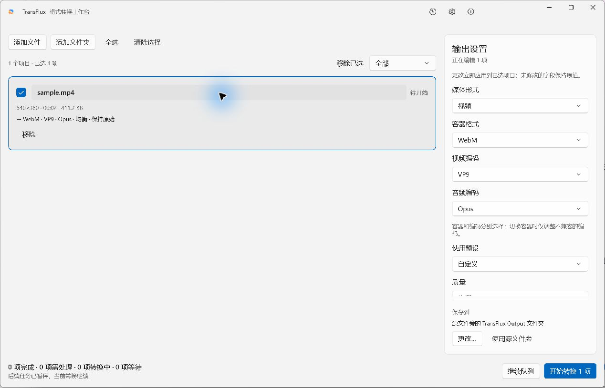
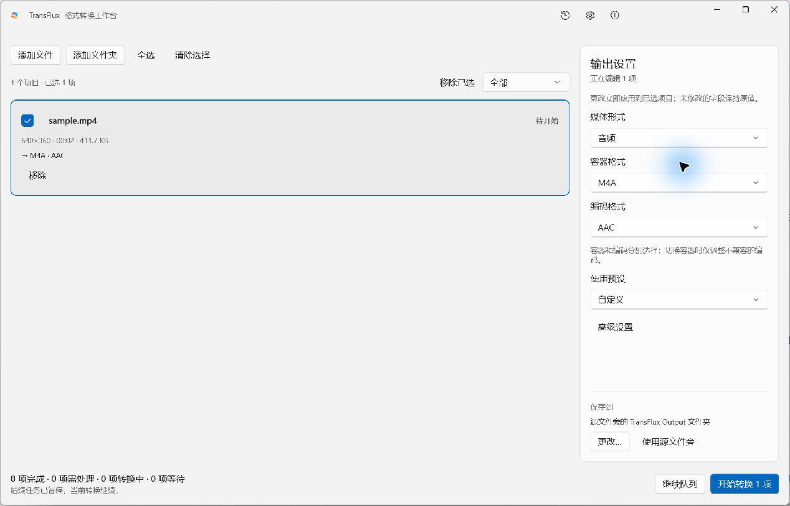

# 输出目标分层与格式扩展 · 2026-11-01

用户要求将媒体形式、容器和编码分开。原先界面仅有六种固定组合，执行层将视频固定为 H.264/AAC、音频容器固定映射成一种编码，校验器也只识别 H.264 和少量音频编码；这属于实现白名单，不是 FFmpeg 能力上限。

## 当前交互

1. 媒体形式：视频、音频。
2. 容器格式：根据媒体形式过滤。
3. 编码格式：视频分别选择视频编码与音频编码；纯音频只选择音频编码。
4. “复制原始编码（转封装）”位于视频编码中，保持媒体与容器概念独立。

切换父级只调整不兼容子项，保留兼容编码、输出路径及其他无关参数。
切换音频编码保留合法采样率/码率，MP3/Opus 的不兼容采样率退回自动，过高码率调整到编码器范围。
多选媒体或容器不一致时提示先统一父级，不误用第一项的编码列表。执行中参数依然只读。
保存位置固定在面板底部，不随编码参数滚动消失。

## 已接入的输出矩阵

| 媒体 | 容器 | 视频编码 | 音频编码 |
|---|---|---|---|
| 视频 | MP4 | H.264、H.265、AV1 | AAC、MP3、ALAC |
| 视频 | MKV | H.264、H.265、AV1、VP9 | AAC、MP3、Opus、Vorbis、FLAC、PCM 16/24-bit |
| 视频 | MOV | H.264、H.265 | AAC、ALAC、PCM 16/24-bit |
| 视频 | WebM | VP9、AV1 | Opus、Vorbis |
| 音频 | M4A | — | AAC、ALAC |
| 音频 | MP3 | — | MP3 |
| 音频 | FLAC | — | FLAC |
| 音频 | WAV | — | PCM 16/24-bit |
| 音频 | OGG | — | Vorbis、Opus |
| 音频 | Opus | — | Opus |
| 音频 | AAC / ADTS | — | AAC |

总计 49 个视频转码组合和 10 个纯音频组合。所有下拉选项来自 Domain 的 OutputFormatCatalog，同一矩阵用于执行前验证。
视频编码使用 libx264/libx265/libaom-av1/libvpx-vp9，音频使用固定核心中对应编码器。
硬件路径仍只接入 H.264；H.265/AV1/VP9 明示使用 CPU。AV1 高分辨率速度尚无性能承诺。

## 实现与兼容性

- ConversionRequest、ConversionOptions、PresetRequestTemplate 新增显式 VideoCodec，默认 H264，旧 JSON 仍按 H.264 恢复。
- 新容器/编码枚举追加到旧值之后，保留所有旧序号。旧 mp4-h264、mkv-h264、mkv-remux、m4a-aac、flac、wav 记忆键继续识别。
- 新的记忆键包含视频与音频编码；复用设置和预设时不丢失所选编码。
- Planner 按所选视频、音频编码构建参数，视频音轨不再被强制转换成 AAC；Muxer 始终显式指定。
- H.265 在 MP4/MOV 输出使用 hvc1 标记；Opus 默认重采样到 48kHz。
- Verifier 检查全部支持的编码、容器族、流数量、尺寸、像素格式、时长和需要的 faststart，再进行采样或全片解码。
- 文件选择器增加“所有文件”，不靠扩展名判定能否读取；目录导入增加常见媒体后缀，实际内容仍由 ffprobe 判断。

## 验证

固定核心：N-128227-g4811625b5f-20261031，已通过本机 `ffmpeg -encoders` 核对所需软件编码器。
OutputFormatTests 从共享矩阵生成全部 59 种组合，实际编码带音轨的 SDR 样片，运行 ffprobe 和全片解码，核对源文件哈希不变。
每种结果另以错误音频编码作为预期，确认校验器拒绝错误结果；不只断言参数字符串。

初次测试发现当前核心拒绝 MOV/AV1，已从矩阵移除；没有把“FFmpeg 存在该编码器”当作“所有容器都支持该编码”。

验证命令：

```powershell
dotnet build TransFlux.slnx -c Debug -p:WindowsPackageType=None --no-restore
dotnet test TransFlux.slnx -c Debug --no-restore --verbosity minimal
```

本记录完成时全项目测试 **259 项通过**：Domain 83、Application 48、Infrastructure 29、Engine 99；解决方案 Debug 构建 0 警告、0 错误。后续工作台缺陷修复新增 6 项应用层测试，当前全量为 **265 项通过**（Application 54）。
新增选择规则测试覆盖父子字段归一化、保持兼容值、转封装/转码切换、编码与预设/请求往返、旧 JSON 和旧记忆键、阻断非法容器编码组合及音频码率/采样率调整。

通过 computer-use 技能在本次源码 Debug 隔离实例检查：任务选中后显示独立媒体形式、容器格式、视频编码和音频编码；容器下拉展示 MP4/MKV/MOV/WebM，切换 WebM 后自动使用 VP9/Opus，视频编码列表仅显示 VP9/AV1/复制。
切换媒体形式为音频后，目标改为 M4A/AAC，视频编码与视频质量字段隐藏，媒体形式、容器格式、编码格式保持独立；保存位置固定可见。
本次隔离数据位于 `artifacts/output-format-smoke`，样片为合成 SDR 视频；未修改同时运行的已安装版数据。
历史工作台截图见 UX-workbench-redesign，不代表当前三级目标面板。





## 保留限制

- 视频转码仍限定原有已支持的 8-bit SDR BT.709 输入；不代表新增了 HDR 色调映射或 10-bit 输出。
- MP3 仅支持单声道/立体声，多声道源要求用户显式选择 1/2 声道，避免无提示降混。
- 文件选择器能选中某后缀不等于任何损坏或不兼容的文件都能转换；错误由探测/兼容性检查给出。
- 无损编码不能恢复有损源丢失的信息；界面明确提示文件可能变大。
- 未更新安装包，本次交付为源码及 Debug 构建。

## 2026-11-01 管线修复（task-2）后的补充

- 视频转码携带字幕：可复制者 -c:s copy，其余转 mov_text/srt/webvtt；位图字幕仅 MKV 直通，其余容器跳过并警告；烧录与外挂字幕暂缓。
- 转封装白名单扩展：MKV 视频加 mpeg2video/mpeg4/vc1/prores/theora/vp8/ffv1 等，音频加 ac3/eac3/truehd/mlp/dts/mp2（DVD VOB→MKV 可用）；MP4/MOV 音频加 ac3/eac3；MKV 保留字体附件（filename/mimetype 显式重建）。
- Dolby Vision 分级：P8（BL compatibility id>0）可 MKV 直通保留 RPU；P5/7 与未知 profile 阻断并说明；DCI-P3（smpte432）不再误判为 DV。
- 多音轨：未显式选流时保留全部音轨，MP4 不再截断；语言与默认/强制轨标记在任何元数据策略下重建。
- 色彩传递：setparams + 输出侧 -color_* 双通道，Verifier 抽查 color_primaries/transfer/space（range 的 tv/unspecified 等价处理，见 MEDIA-PIPELINE-FIXES.md）。
- 全量测试：Domain 120、Application 96、Infrastructure 32、Engine.Integration 118，共 366 项通过（基线 265 项保持，其中 Remux_BitmapSubtitle_IsBlocked 按新行为拆分为 MKV 放行 + MP4 阻断两个用例）。
