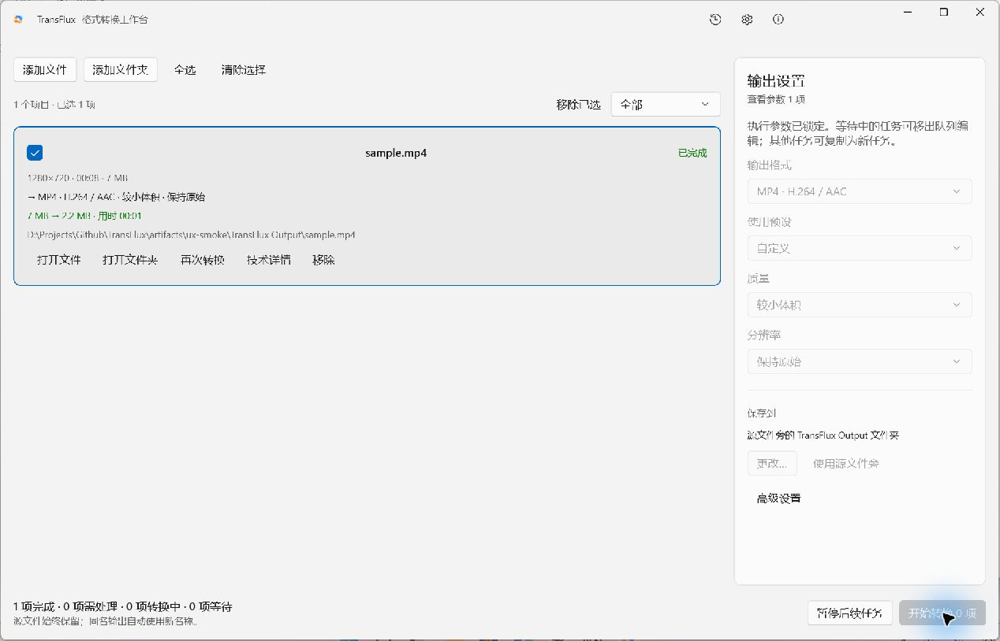
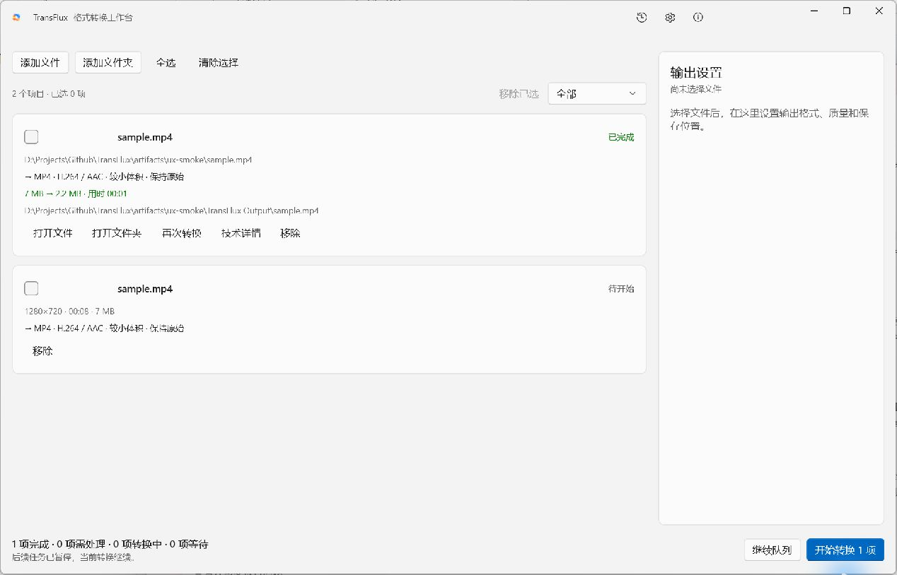

# UX 工作台重构 · 2026-11-01

本记录对应用户确认的文件优先 UX 重构。当前规范为 [03 UI/UX](../03-ui-ux.md)，取代此前格式目录/固定表格/参数及批处理模态窗口。

## 已实现

- 左侧任务卡片、右侧所选参数、底部执行栏；导入批次自动选择，单选/多选使用同一参数作用范围。
- 格式、预设、质量、尺寸、输出目录即时编辑；不同字段显示混合值，修改只触及所改字段。
- 高级区按转换方式显示；提供单项音轨选择。自建预设保留精确编码参数，不保存源文件特定信息。
- 同一 MediaId 卡片显式关联 JobId。入队时锁定参数，等待任务可移出编辑，其他任务可复制。
- 取消、移除、重试、再次转换分开。移除不隐藏执行中的任务；撤销恢复卡片；进程停止前保持正在取消状态。
- 读取并发限制及逐项取消；完整工作台持久化。恢复未开始文件、任务结果和输出入口，启动不自动执行等待任务。
- 并发限制运行时生效；回退/验证策略按任务开始时捕获；修复队列满载时暂停后仍启动下一项的问题。
- 正常退出保存工作台；活动任务关闭提示继续/取消退出，等待安全终态。保存失败不继续关闭。
- 开始前兼容性、无效裁剪与字幕丢失提示；中文故障建议，计划/日志移到技术详情。
- 转封装遵守元数据策略，清除全局和流级元数据；已提交输出的崩溃恢复补齐成功状态。
- 设置保存等待实际结果，失败留窗；撤下无实际实现的语言和日志清理控制。

## 自动化验证

运行命令：

```powershell
dotnet build TransFlux.slnx -c Debug -p:WindowsPackageType=None --no-restore --verbosity minimal
dotnet test TransFlux.slnx -c Debug --no-restore --verbosity minimal
dotnet run --project tools/TransFlux.E2E/TransFlux.E2E.csproj -c Debug --no-restore
```

本轮测试（重构当时快照）：Domain 83、Application（含工作台）37、Infrastructure 29、Engine 40，共 **189 项通过**。
完整解决方案构建 **0 警告、0 错误**。

> 后续输出格式扩展新增 70 项测试（OutputSelectionTests 11 + OutputFormatTests 59）；再经工作台缺陷修复新增 6 项，当前全量测试为 **265 项通过**，见 [格式扩展记录](OUTPUT-FORMATS.md)。

新增测试覆盖：选中导入批次、批量只改触及字段、执行参数冻结、拒绝移除运行项、取消进程、移出队列编辑、
同源文件独立转换、重试保留卡片、读取限流/取消/撤销、裁剪阻断、精确预设往返、工作台 SQLite 重开、
队列满载暂停、动态提高/降低并发及逐任务验证策略、初始快照输出和空快照完成信号、移除中断卡片后重启不再出现、持久化卡片绑定完成前不启动新任务。
元数据测试实际生成带个人标记的媒体，运行转封装并检查输出中的全局/流标签，而不只检查命令参数。

真实 E2E 使用固定 FFmpeg 核心 N-128227-g4811625b5f-20261031：

```text
work=...\Temp\transflux-e2e-3cb09292
sample bytes=4595865
source streams=2 color=SdrBt709 duration=5000000us
Queued → Preflighting → Running → Verifying → Committing → Succeeded
output probe ok=True video=1 audio=1 1280x720 codec=h264
source unchanged=True
E2E_RESULT=PASS
```

## 原生窗口检查

通过 computer-use 技能在真实 WinUI/Reactor 窗口检查，使用独立 `artifacts/ux-smoke/state` 数据库，未使用用户已安装程序的数据。
Debug 构建支持 `TRANSFLUX_DATA_DIR` 指向隔离目录；Release 不启用此覆盖。

已观察：空态、系统添加文件选择器、已恢复媒体卡片、选择后参数区、质量即时更新、真实转换成功、
参数冻结、输出大小/耗时/路径、再次转换保留原结果并新建待开始卡片、展开高级区、关闭再启动后恢复结果和未开始卡片且队列暂停。
8 秒 SDR 720p 样片以 CPU 转码，从约 7 MB 生成 **2,352,662 字节**输出，数据库状态 Succeeded，卡片显示约 2.2 MB。
UI 自动化对系统 PickerHost 无法取得独立可操作窗口，未宣称完成系统文件选择器选中文件的全链路验证；
后续界面转换检查使用隔离工作台种子恢复样片，文件导入命令本身由工作台测试覆盖。

截图：





## 未覆盖的验收范围

- Narrator、高对比、200% 文本缩放、最小窗口和完整深色主题矩阵仍需专门验收。
- 运行中退出的完整交互、磁盘故障与崩溃注入未做完整原生窗口故障矩阵。
- 未生成或安装新版安装包；本次验证是源码 Debug 构建。旧安装版及旧截图不自动更新。
- 转码范围仍受原有媒体兼容性矩阵约束；不新增 HDR 色调映射、图片转换或完整字幕编辑。
- 初始事件快照中的失败详情主要来自 Attempt；在创建 Attempt 之前失败的历史原因仍有持久化信息不足的限制。
